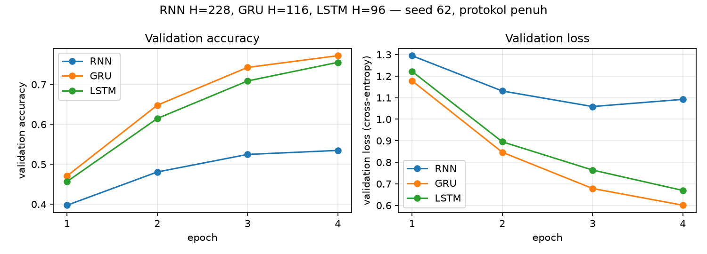
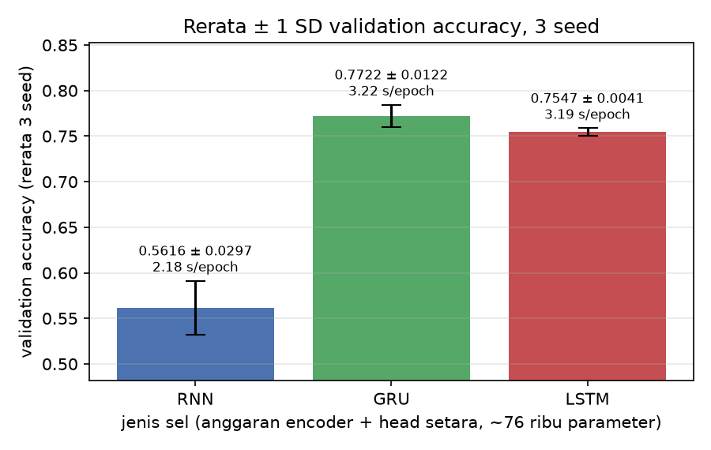

# Laporan Praktikum M08 - LSTM dan GRU

## Identitas Praktikan

| Komponen | Isian |
|---|---|
| Nama | Abdillah Fikri Alpome |
| NIM | 123450062 |
| Kelas | RA |
| Modul | M08 - LSTM dan GRU |
| Tanggal praktikum | 2026-11-11 |
| Seed/varian individual | 121, 122, 123 (BASE_SEED = 4 digit terakhir NIM) |
| Device | CPU (1 inti, tanpa GPU) |

## Ringkasan Singkat

Praktikum ini membandingkan RNN, GRU, dan LSTM pada klasifikasi topik AG News (4 kelas) dengan anggaran parameter encoder + head disetarakan sekitar 76 ribu (RNN H=228, GRU H=116, LSTM H=96), 6.000 contoh latih, 1.500 validasi, dan 4 epoch. Dengan tiga seed, LSTM memperoleh validation accuracy 0,7760 ± 0,0044 dan GRU 0,7724 ± 0,0069, sedangkan RNN hanya 0,5880 ± 0,0123. Selisih LSTM-GRU (0,36 poin persentase) lebih kecil dari variasi antar-seed, sehingga keduanya tidak dapat dibedakan. RNN paling cepat (4,81 s/epoch) tetapi tertinggal sekitar 18 poin. GRU dipilih untuk perangkat terbatas sebagai *tie-break* karena akurasinya setara LSTM dan tanpa cell state.

## 1. Tujuan dan Hipotesis

### 1.1 Tujuan

1. Menghitung dan membuktikan jumlah parameter RNN, GRU, dan LSTM, lalu menyetarakan anggaran encoder + head dengan selisih maksimum 1%.
2. Membandingkan akurasi dan biaya waktu ketiga sel pada anggaran setara dengan tiga seed.
3. Memilih satu model untuk perangkat terbatas dengan bukti angka.

### 1.2 Hipotesis sebelum eksperimen

| Perbandingan | Prediksi | Alasan teknis |
|---|---|---|
| RNN vs GRU/LSTM (anggaran setara) | GRU dan LSTM lebih akurat daripada RNN | Gerbang dan jalur cell state menjaga informasi sepanjang 60 langkah, sedangkan RNN meluruhkannya (kurva retensi f^T) |
| GRU vs LSTM | Selisih akurasi kecil | Keduanya bergerbang dengan kapasitas parameter yang sama |
| Waktu per epoch | RNN < GRU < LSTM | Urutan jumlah blok gerbang (1, 3, 4) |

## 2. Data dan Protokol Eksperimen

### 2.1 Dataset dan split

| Komponen | Nilai |
|---|---|
| Dataset | AG News (Zhang dkk., 2015), `train.csv` (120.000 baris) |
| Jumlah kelas/target | 4 |
| Train | 6.000 contoh (80% dari subset 7.500) |
| Validation | 1.500 contoh (20%) |
| Test | `test.csv` (7.600) tidak dipakai |
| Cara split | Terstratifikasi, `random_state=121`; split tetap untuk ketiga seed |
| Praproses utama | Huruf kecil, tokenisasi regex, potong/bantal ke 60 token, packing sequence |

Vocabulary (11.862 token, `min_freq=2`) dibangun dari data latih saja; 6,80% token validasi menjadi `<unk>`, dan test set tidak disentuh.

### 2.2 Konfigurasi yang dikendalikan

| Komponen | Nilai yang digunakan |
|---|---|
| Arsitektur dasar | Embedding 100 (`padding_idx=0`) + encoder satu lapis + Linear 4 kelas, memakai `h_n` terakhir |
| Loss function | Cross-entropy |
| Optimizer | Adam, clip norma gradien 1,0 |
| Learning rate | 1e-3 |
| Batch size | 64 |
| Epoch/jumlah update | 4 epoch = 376 update |
| Seed | 121, 122, 123 (mengubah inisialisasi dan urutan batch, bukan split) |
| Kriteria pemilihan model | Checkpoint dengan validation loss terendah |
| Batas komputasi | Anggaran encoder + head ~76 ribu parameter, CPU 1 inti |

**Variabel yang dibuat sama untuk seluruh run:** data, split, vocabulary, packing, optimizer, learning rate, batch, jumlah update.  
**Variabel yang sengaja diubah:** jenis sel dan hidden size (RNN 228, GRU 116, LSTM 96), serta seed.

### 2.3 Lingkungan eksekusi

```text
Python     : 3.12.3
PyTorch    : 2.15.0+cu132
NumPy      : 2.5.4
Device     : CPU
Runtime    : Sandbox Linux, 1 inti CPU
```

## 3. Implementasi dan Pemeriksaan Kebenaran

| Pemeriksaan | Nilai yang diharapkan | Hasil aktual | Status |
|---|---:|---:|---|
| Retensi f^T, f=0,9, T=20 | 0,9^20 = 0,1216 | 0,1216 | Lulus |
| Bentuk `h_n` RNN/GRU/LSTM | (1, 4, 32) | (1, 4, 32) | Lulus |
| Bentuk `c_n` (hanya LSTM) | (1, 4, 32) | (1, 4, 32) | Lulus |
| Parameter encoder + head, H=96 (RNN/GRU/LSTM) | 19.396 / 57.412 / 76.420 | sama dengan PyTorch | Lulus |
| Parameter encoder + head, anggaran setara | 76.156 / 76.332 / 76.420 | sama dengan PyTorch | Lulus |
| Selisih anggaran maksimum | ≤ 1% | 0,35% | Lulus |
| Logit satu batch uji | (4, 4) | (4, 4) | Lulus |

**Temuan dari pemeriksaan:** Rumus G·H·(E+H+2) dengan G = 1, 3, 4 cocok tepat dengan PyTorch. Pada H yang sama LSTM memiliki sekitar 3,9 kali parameter RNN, sehingga anggaran harus disetarakan. Embedding (1.186.200 parameter, 94% dari total) sama untuk ketiga model, sehingga ukuran model hampir identik (4,816-4,817 MiB fp32).

## 4. Hasil Eksperimen

### 4.1 Tabel hasil utama

Nilai disalin dari `M08_123450062_metrics.csv`. Waktu/epoch berderau pada CPU satu inti.

| Run | Hidden | Param. enc+head | Train loss | Val. loss | Val. acc | Norma grad. rata-rata | Waktu/epoch (s) | Best epoch |
|---|---:|---:|---:|---:|---:|---:|---:|---:|
| rnn-s121 | 228 | 76.156 | 0,6254 | 0,9849 | 0,5953 | 2,32 | 4,92 | 4 |
| gru-s121 | 116 | 76.332 | 0,2991 | 0,6338 | 0,7627 | 1,30 | 6,48 | 4 |
| lstm-s121 | 96 | 76.420 | 0,3383 | 0,6196 | 0,7707 | 1,22 | 6,62 | 4 |
| rnn-s122 | 228 | 76.156 | 0,7014 | 1,0433 | 0,5707 | 2,21 | 4,77 | 4 |
| gru-s122 | 116 | 76.332 | 0,3903 | 0,6360 | 0,7767 | 1,35 | 6,68 | 3 |
| lstm-s122 | 96 | 76.420 | 0,3178 | 0,6789 | 0,7813 | 1,28 | 6,81 | 4 |
| rnn-s123 | 228 | 76.156 | 0,6382 | 1,0179 | 0,5980 | 2,14 | 4,75 | 4 |
| gru-s123 | 116 | 76.332 | 0,3076 | 0,6225 | 0,7780 | 1,26 | 6,83 | 4 |
| lstm-s123 | 96 | 76.420 | 0,3303 | 0,6410 | 0,7760 | 1,23 | 6,90 | 4 |

Ringkasan tiga seed (SD populasi, ddof=0):

| Model | Seed | Validation accuracy (mean ± SD) | Waktu/epoch (mean, s) |
|---|---:|---:|---:|
| RNN (H=228) | 3 | 0,5880 ± 0,0123 | 4,81 |
| GRU (H=116) | 3 | 0,7724 ± 0,0069 | 6,66 |
| LSTM (H=96) | 3 | 0,7760 ± 0,0044 | 6,78 |

### 4.2 Grafik atau visualisasi utama



**Gambar 1.** Validation accuracy (kiri) dan validation loss (kanan) per epoch untuk RNN H=228, GRU H=116, dan LSTM H=96 pada seed 121 (6.000 latih, 1.500 validasi).

**Temuan dari Gambar 1:** GRU dan LSTM hampir berimpit sepanjang epoch dan mencapai 0,7627 dan 0,7707 pada epoch 4, sedangkan RNN hanya 0,5953. Kurva ketiganya masih turun pada epoch 4 (best epoch = 4 pada 8 dari 9 run), jadi model belum konvergen.



**Gambar 2.** Rerata ± 1 SD validation accuracy tiga seed per jenis sel, dengan anotasi waktu per epoch. Sumbu y tidak dimulai dari nol.

**Temuan dari Gambar 2:** error bar GRU (0,7724 ± 0,0069) dan LSTM (0,7760 ± 0,0044) saling tumpang-tindih, sedangkan RNN berjarak sekitar 18-19 poin dari keduanya.

## 5. Analisis dan Pembahasan

| Unsur | Isi |
|---|---|
| Klaim | Pada anggaran parameter setara, sel bergerbang jauh lebih akurat daripada RNN polos, tetapi GRU dan LSTM tidak dapat dibedakan |
| Bukti | Tabel 4.1 dan Gambar 2: LSTM 0,7760, GRU 0,7724, RNN 0,5880 |
| Penalaran | Kurva retensi menunjukkan informasi awal hanya bertahan jika faktor pengali per langkah mendekati 1; gerbang melupakan secara selektif sehingga informasi lebih mudah bertahan pada deret sepanjang 60 token |

1. **Perbandingan dengan hipotesis:** Hipotesis RNN terburuk didukung (selisih 18,4 poin dari GRU dan 18,8 poin dari LSTM). Hipotesis GRU ≈ LSTM didukung: selisih 0,36 poin, lebih kecil dari SD kedua model, dan LSTM menang di 2 dari 3 seed (+0,80, +0,46, -0,20 poin). Hipotesis urutan waktu RNN < GRU < LSTM didukung untuk RNN, tetapi selisih GRU-LSTM hanya 1,7% (0,11 s), sebanding dengan SD waktu antar-seed (0,12-0,15 s).
2. **Run terbaik dan terburuk:** Terbaik `lstm-s122` (0,7813), terburuk `rnn-s122` (0,5707). RNN menunjukkan norma gradien rata-rata terbesar (2,22 vs 1,30 GRU dan 1,24 LSTM; dicatat sebelum clipping) dan loss validasi tertinggi, sehingga pelatihannya lebih sulit, meskipun data saya tidak membuktikan vanishing gradient secara langsung.
3. **Trade-off:** RNN 28% lebih cepat daripada GRU (4,81 vs 6,66 s/epoch) tetapi akurasinya turun 18,4 poin, jadi penghematan itu tidak sepadan. GRU dan LSTM hampir identik pada akurasi, waktu, dan ukuran model.
4. **Anomali atau hasil gagal:** `gru-s122` memilih checkpoint epoch 3 (best epoch = 3), karena validation loss epoch 4 (0,6412) lebih tinggi daripada epoch 3 (0,6360) walau akurasi naik. Run RNN memiliki variasi paling besar (SD 0,0123).
5. **Generalisasi:** Gap train-val loss rata-rata sekitar 0,30 (GRU 0,33 vs 0,63) dan 0,32 (LSTM 0,33 vs 0,65), serta 0,36 untuk RNN (0,66 vs 1,02). Gap itu wajar untuk 6.000 contoh dengan embedding 1,19 juta parameter yang dilatih dari nol.

## 6. Jawaban Pertanyaan Modul

1. **Parameter pada H=96 dan mengapa tidak adil?** RNN 19.396, GRU 57.412, LSTM 76.420 (encoder + head). Pada H sama LSTM memiliki sekitar 3,9 kali parameter RNN, sehingga perbedaan akurasi bercampur antara efek arsitektur dan kapasitas.
2. **Model dengan rerata akurasi tertinggi dan variasi antar-seed?** LSTM (0,7760 ± 0,0044), diikuti GRU (0,7724 ± 0,0069) dan RNN (0,5880 ± 0,0123). Selisih LSTM-GRU (0,36 poin) lebih kecil daripada variasi antar-seed; selisih terhadap RNN jauh melampauinya.
3. **Model tercepat dan kesesuaian urutan?** RNN (4,81 s/epoch), lalu GRU (6,66) dan LSTM (6,78). Urutan sesuai jumlah gerbang (1, 3, 4) tetapi tidak sebanding (GRU hanya 1,39 kali RNN), karena anggaran parameter setara membuat jumlah perkalian matriks per langkah hampir sama.
4. **Kurva f^T dan vanishing gradient pada LSTM?** Retensi f=0,9 hanya 0,1216 setelah 20 langkah dan 0,0018 setelah 60 langkah, sedangkan f=0,99 masih 0,8179 dan 0,5472. LSTM tetap dapat mengalami vanishing gradient karena f<1 meluruhkan gradien secara geometris, dan gradien lewat jalur `h` melalui turunan gerbang yang bernilai di bawah 1.
5. **Model untuk perangkat terbatas?** GRU: akurasi 0,7724 (hanya 0,36 poin di bawah LSTM, dalam variasi seed), 6,66 s/epoch (1,7% lebih cepat dari LSTM), dan ukuran 4,816 MiB (sama dengan LSTM). RNN ditolak (akurasi 0,5880). Pilihan GRU bersifat *tie-break*, bukan bukti keunggulan atas LSTM.

## 7. Kesimpulan dan Keterbatasan

### 7.1 Kesimpulan

Pada anggaran encoder + head ~76 ribu parameter, sel bergerbang unggul jauh atas RNN polos: LSTM 0,7760 dan GRU 0,7724 vs RNN 0,5880. LSTM dan GRU tidak dapat dibedakan (selisih 0,36 poin < SD 0,0044-0,0069), dan keduanya memakan waktu 6,66-6,78 s/epoch, sekitar 1,4 kali RNN (4,81 s). Untuk perangkat terbatas, GRU dipilih sebagai *tie-break* karena tidak memiliki cell state dan setara akurasinya dengan LSTM; trade-off utamanya adalah RNN yang lebih cepat tetapi terlalu tidak akurat.

### 7.2 Keterbatasan

- Hanya tiga seed dan satu split tetap, sehingga SD (ddof=0) menaksir variasi inisialisasi dan urutan batch saja; selisih kecil seperti LSTM vs GRU tidak dapat disimpulkan.
- Hanya 4 epoch (376 update); sebagian besar run memilih epoch 4 sehingga belum konvergen dan peringkat dapat berubah.
- Pengukuran waktu pada CPU satu inti berderau, dan run berjalan berurutan sehingga selisih 1-2% antara GRU dan LSTM tidak dapat dipercaya.
- Tanpa pengujian hidden size sama (H=96) dan tanpa test set, sehingga efek kapasitas murni dan estimasi tak bias pada data baru tidak terukur.

### 7.3 Tindak lanjut

Mengulang perbandingan GRU vs LSTM dengan 10 seed dan 10-15 epoch pada anggaran yang sama. Percobaan ini paling bernilai karena selisihnya sekarang lebih kecil daripada variasi seed, dan model belum konvergen pada 4 epoch.

## Referensi

1. Zhang, X., Zhao, J., LeCun, Y. 2015. Character-level Convolutional Networks for Text Classification. NeurIPS. https://arxiv.org/abs/1509.01626
2. Hochreiter, S., Schmidhuber, J. 1997. Long Short-Term Memory. Neural Computation 9(8). https://doi.org/10.1162/neco.1997.9.8.1735
3. Cho, K. dkk. 2014. Learning Phrase Representations using RNN Encoder-Decoder for Statistical Machine Translation. EMNLP. https://arxiv.org/abs/1406.1078
4. Dokumentasi PyTorch 2.15 (`nn.RNN`, `nn.GRU`, `nn.LSTM`, `pack_padded_sequence`). https://pytorch.org/docs/stable/

## Pernyataan Orisinalitas

[ISI SENDIRI SETELAH ANDA MEMBACA, MEMAHAMI, DAN MEMVERIFIKASI SEMUA ISI LAPORAN. Cantumkan bantuan AI jika aturan mata kuliah mengharuskan.]

**Nama:** Ahmad Farhan Ghani  
**Tanggal:** [YYYY-MM-DD]

---

## Checklist Sebelum Mengumpulkan

- [x] Nama berkas laporan adalah `M08_123450062.md`.
- [x] Identitas, seed, device, dan versi library telah diisi.
- [x] Isi laporan tidak melebihi batas kata modul (periksa ulang setelah Anda mengedit).
- [x] Protokol sama dengan modul (6.000/1.500, 4 epoch, 3 seed).
- [x] Tabel hasil konsisten dengan `M08_123450062_metrics.csv`.
- [x] Seluruh run dicantumkan (sembilan run).
- [x] Grafik memiliki judul, label sumbu, legenda, dan caption.
- [x] Setiap klaim utama disertai angka atau rujukan gambar/tabel.
- [x] Test set tidak digunakan untuk memilih model atau hyperparameter.
- [x] Kesimpulan menjawab tujuan dan menyebutkan trade-off.
- [x] Sumber eksternal telah dicantumkan.
- [ ] Pernyataan orisinalitas telah diisi.
- [x] Notebook lolos Restart Kernel and Run All (dijalankan dari awal tanpa galat).
- [x] Tiga berkas pengumpulan (`ipynb`, laporan `md`, dan `metrics.csv`) tersedia.
