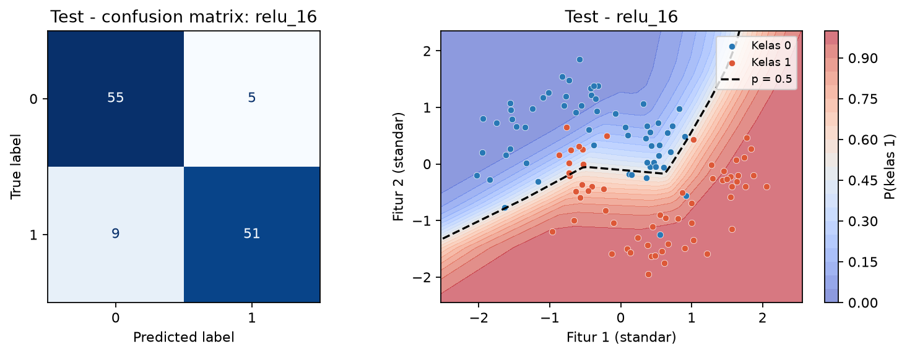

# Laporan Praktikum M01 - Fondasi Jaringan Saraf, FNN, Aktivasi, dan Loss

## Identitas Praktikan

| Komponen | Isian |
|---|---|
| Nama | Abdillah Fikri Alpome |
| NIM | 123450062 |
| Kelas | RC |
| Modul | M01 - Fondasi Jaringan Saraf, FNN, Aktivasi, dan Loss |
| Tanggal praktikum | 2026-10-27 |
| Seed/varian individual | 1062 |
| Device | CPU, 1 thread |

## Ringkasan Singkat

Delapan run mencakup baseline, latihan tanh, dan enam kombinasi wajib. relu_16 dipilih dengan validation loss 0.250017; test loss 0.293826 dan accuracy 0.8833 diperoleh dari satu evaluasi. Seluruh hasil diperoleh dari eksekusi dengan seed individual.

## 1. Tujuan dan Hipotesis

### 1.1 Tujuan

Memverifikasi implementasi sesuai protokol, membandingkan konfigurasi terkendali, dan membahas hasil berdasarkan angka eksperimen sendiri.

### 1.2 Hipotesis sebelum eksperimen

Hidden 16 diperkirakan menurunkan loss dibanding hidden 4; tanh diperkirakan lebih mudah dioptimalkan daripada sigmoid. Prediksi latihan: loss awal berubah, boundary tanh lebih halus, dan tanh dapat menurun lebih cepat.

## 2. Data dan Protokol Eksperimen

### 2.1 Dataset dan split

make_moons 600 titik, noise 0,22; split terstratifikasi train/validation/test 360/120/120, seed 1062. StandardScaler hanya di-fit pada train.

### 2.2 Konfigurasi yang dikendalikan

FNN 2-h-1, h=4/16 pada enam run; baseline/latihan h8. SGD lr 0,05, batch 32, 200 epoch, bobot dan urutan batch terkendali. Pemilihan memakai validation loss akhir enam run wajib.

### 2.3 Lingkungan eksekusi

Python 3.14.7; PyTorch 2.14.0+cpu; NumPy 2.5.3; CPU lokal DSWorkbench, kernel baru Run All. Versi dan jumlah thread tercetak di notebook.

## 3. Implementasi dan Pemeriksaan Kebenaran

Forward manual z1=h=(1,5;1), logit 2,5, p 0,924142, BCE 0,078890; 9 parameter. Seluruh tahap NumPy-PyTorch diperiksa <1e-6. Baseline 33 parameter; hidden 4=17 dan hidden 16=65. Delapan run dan satu test lolos assertion.

## 4. Hasil Eksperimen

### 4.1 Tabel hasil utama

| Run | Param. | Train BCE | Val. BCE | Val. acc | Detik/epoch |
|---|---|---|---|---|---|
| baseline_relu_h8 | 33 | 0.2490 | 0.2900 | 0.8750 | 0.0074 |
| latihan_tanh_h8 | 33 | 0.2808 | 0.3095 | 0.8667 | 0.0071 |
| relu_4 | 17 | 0.2382 | 0.2733 | 0.8750 | 0.0067 |
| relu_16 | 65 | 0.2113 | 0.2500 | 0.9083 | 0.0073 |
| tanh_4 | 17 | 0.2845 | 0.3104 | 0.8667 | 0.0074 |
| tanh_16 | 65 | 0.2804 | 0.3108 | 0.8667 | 0.0067 |
| sigmoid_4 | 17 | 0.2934 | 0.3130 | 0.8667 | 0.0068 |
| sigmoid_16 | 65 | 0.2842 | 0.3085 | 0.8667 | 0.0072 |

### 4.2 Grafik atau visualisasi utama

**Gambar 1.** Confusion matrix dan decision boundary model final pada 120 titik test; colorbar menunjukkan P(kelas 1), garis putus-putus p=0,5. Satu titik bernilai 0,83 poin persentase accuracy.

## 5. Analisis dan Pembahasan

Hidden yang lebih besar tidak selalu memperbaiki validation loss pada eksperimen ini. relu: hidden 4=0.273305, hidden 16=0.250017; tanh: hidden 4=0.310414, hidden 16=0.310750; sigmoid: hidden 4=0.313029, hidden 16=0.308509. Kapasitas meningkat dari 17 menjadi 65 parameter, tetapi peringkat tetap dipengaruhi aktivasi dan anggaran optimisasi. Konfigurasi sigmoid_4 dan sigmoid_16 memperoleh accuracy 0.8667 dan 0.8667, tetapi BCE 0.313029 dan 0.308509. Accuracy menilai kelas setelah threshold 0,5; BCE juga memperhitungkan keyakinan probabilitas. Pada latihan hidden 8, tanh menghasilkan validation loss 0.309467, dibanding ReLU 0.289999. Aktivasi halus tidak otomatis memberi BCE lebih rendah.

## 7. Kesimpulan dan Keterbatasan

### 7.1 Kesimpulan

Model relu_16 memiliki validation accuracy 0.9083 dan test accuracy 0.8833. Pemilihan berdasarkan BCE, bukan accuracy.

### 7.2 Keterbatasan

Kesimpulan terbatas pada 600 titik make_moons, satu seed 1062, noise 0,22, dan SGD selama 200 epoch. Dataset sintetis kecil ini belum mewakili citra, teks, atau domain lain; peringkat aktivasi dapat berubah ketika data atau optimizer diganti.

### 7.3 Tindak lanjut

Ulangi eksperimen pada beberapa seed dan anggaran yang lebih panjang untuk menilai apakah pola tetap bertahan.

## Referensi

1. Materi dan starter resmi DSWorkbench Deep Learning versi 0.4.13.
2. Fabio Banyu Cyto. Implementasi praktikum Deep Learning, diadaptasi dengan izin. https://github.com/fabiobanyu/deep-learning-123450104
3. PyTorch Contributors. Dokumentasi PyTorch. https://docs.pytorch.org/docs/stable/
4. torchvision / scikit-learn untuk pemuatan dataset dan pembagian data sesuai modul.

## Pernyataan Orisinalitas

Implementasi mengadaptasi kode praktikum Fabio Banyu Cyto dengan izin serta starter DSWorkbench. Seluruh perhitungan dijalankan ulang menggunakan NIM individual. OpenAI Codex digunakan untuk membantu implementasi, pemeriksaan, dan penyusunan draf pembahasan. Hasil ini tidak diklaim sebagai kode yang seluruhnya ditulis tanpa bantuan. Praktikan meninjau dan memahami laporan sebelum pengumpulan.

**Nama:** Abdillah Fikri Alpome

**Tanggal:** 2026-10-27

## Checklist Sebelum Mengumpulkan

- [x] Identitas, seed, versi, device, dan sumber terisi.
- [x] Notebook selesai kernel baru Run All; angka laporan mengikuti hasil aktual.
- [x] Semua run tercatat dan grafik berlabel.
- [x] Pemilihan tidak menggunakan test; M02 tidak memakai split test.
- [ ] Praktikan meninjau laporan, mengisi formulir analisis, dan mengumpulkan tugas.
