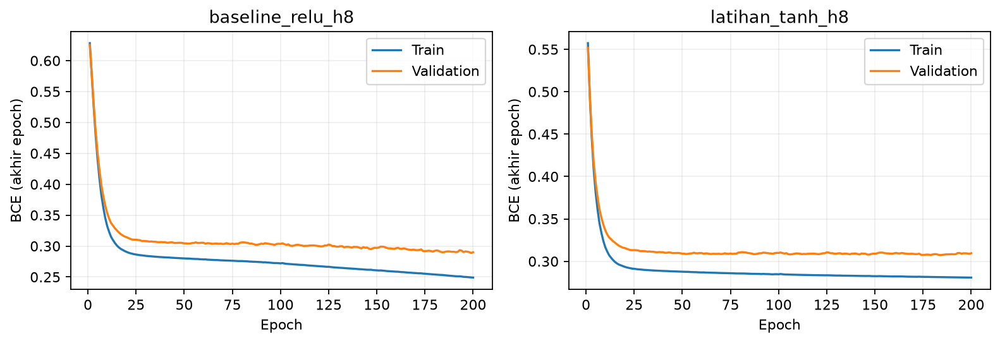
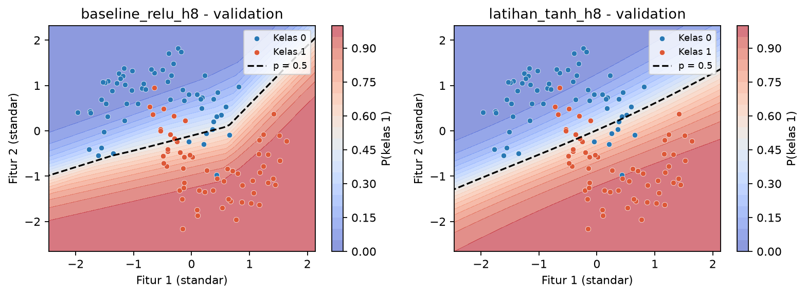

# Latihan Mandiri Modul 01

Abdillah Fikri Alpome | 123450062 | RC | 2026-10-27 | seed 1062

## Prediksi sebelum menjalankan

Digit terakhir NIM adalah 2, sehingga aktivasi latihan tanh. Saya memperkirakan loss awal berubah, tanh berpotensi lebih cepat karena berpusat di nol, dan boundary lebih halus daripada ReLU. Semua komponen lain tetap: hidden 8, 33 parameter, SGD 0,05, batch 32, 200 epoch, split dan bobot awal sama.

## Hasil aktual

| Besaran | ReLU baseline | Tanh latihan |
|---|---|---|
| Val loss awal | 0.677447 | 0.629952 |
| Val loss akhir | 0.289999 | 0.309467 |
| Val accuracy | 0.8750 | 0.8667 |

**Gambar 1.** BCE train dan validation sepanjang 200 epoch, label garis menunjukkan split dan aktivasi. Kecepatan konvergensi dibandingkan dalam epoch, bukan runtime mesin semata.

**Gambar 2.** Boundary pada validation set yang sama; garis p=0,5 membedakan keputusan, colorbar menunjukkan probabilitas.

## Perbandingan prediksi dan hasil

Loss awal berubah sebesar -0.047496. Sebagai perbandingan deskriptif laju penurunan, ambang BCE validasi 0,30 dicapai baseline pada epoch 120, sedangkan tanh: tidak tercapai sampai epoch 200. Pada akhir 200 epoch, BCE tanh dikurangi ReLU adalah +0.019468; dugaan tanh lebih baik tidak didukung oleh loss akhir. Boundary tanh lebih halus secara bentuk fungsi, tetapi kehalusan tidak menjamin generalisasi lebih baik. Histori seluruh epoch tersimpan di hasil/ dan bukan disalin dari run NIM lain.

Satu seed dan dataset sintetis membatasi kesimpulan. Implementasi mengadaptasi kode praktikum Fabio Banyu Cyto dengan izin serta starter DSWorkbench. Seluruh perhitungan dijalankan ulang menggunakan NIM individual. OpenAI Codex digunakan untuk membantu implementasi, pemeriksaan, dan penyusunan draf pembahasan.
