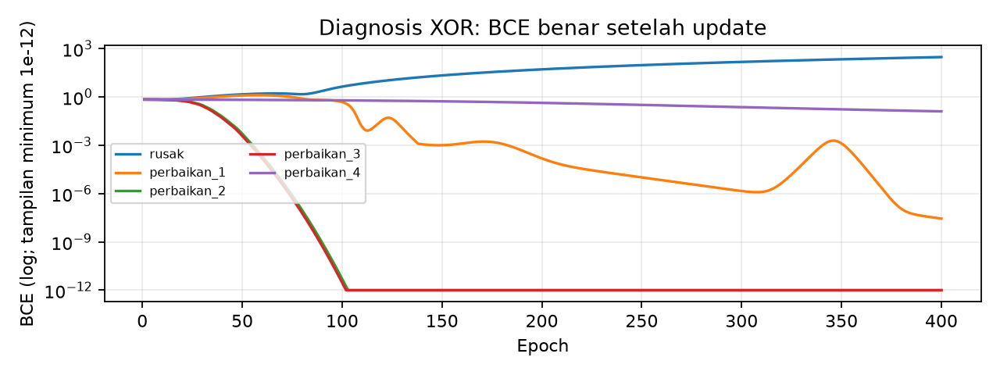

# Laporan Praktikum M02 - Backpropagation dan Automatic Differentiation

## Identitas Praktikan

| Komponen | Isian |
|---|---|
| Nama | Abdillah Fikri Alpome |
| NIM | 123450062 |
| Kelas | RC |
| Modul | M02 - Backpropagation dan Automatic Differentiation |
| Tanggal praktikum | 2026-10-27 |
| Seed/varian individual | 62 |
| Device | CPU, 1 thread |

## Ringkasan Singkat

Gradien manual cocok dengan autograd dan finite difference pada Kasus 1, perluasan 3 neuron, tanh dan batch 2. Relative error batch maksimum 4.133e-10. Loop benar mencapai BCE 0.126864 dengan 4/4 benar; target loss<0,1 belum terpenuhi.

## 1. Tujuan dan Hipotesis

### 1.1 Tujuan

Memverifikasi implementasi sesuai protokol, membandingkan konfigurasi terkendali, dan membahas hasil berdasarkan angka eksperimen sendiri.

### 1.2 Hipotesis sebelum eksperimen

Mengganti ReLU dengan tanh diperkirakan mengecilkan norma dW1 pada Kasus 1 karena faktor 1-tanh(z1)^2<1; perubahan p-y tetap harus diperhitungkan. Epsilon terlalu kecil diperkirakan meningkatkan error.

## 2. Data dan Protokol Eksperimen

### 2.1 Dataset dan split

Kasus 1 tetap x=(2,-1),y=1; W1=[[0,5;-0,5],[1;1]], b1=0, W2=(2,-1), b2=0,5. Batch menambah x2=(-1,3),y2=0. Diagnosis memakai empat titik XOR tanpa validation/test.

### 2.2 Konfigurasi yang dikendalikan

Float64, seed 62, loop 2-4-1, SGD 0,1 selama 400 epoch. Neuron ketiga memakai W1=(-1;0,5), bias 0,25, W2=-0,5. Mean loss dipakai untuk batch. Metrics 20 kolom asli ditambah record_type wajib checkpoint.

### 2.3 Lingkungan eksekusi

Python 3.14.7; PyTorch 2.14.0+cpu; NumPy 2.5.3; CPU lokal DSWorkbench, kernel baru Run All. Versi dan jumlah thread tercetak di notebook.

## 3. Implementasi dan Pemeriksaan Kebenaran

Seluruh 9 komponen Kasus 1/tanh dan 13 komponen perluasan/batch diuji. Nilai maksimum relative error Kasus 1 1.122e-10; epsilon1e-9 1.275e-06. Akumulasi dua backward menghasilkan gradien2x; reset memulihkan1x. Loop bersih identik dengan perbaikan4.

## 4. Hasil Eksperimen

### 4.1 Tabel hasil utama

| Tahap | Loss awal | Loss akhir | Benar | Norma L2 |
|---|---|---|---|---|
| rusak | 0.70538 | 2.979e+02 | 3/4 | 56.8334 |
| perbaikan_1 | 0.68801 | 2.791e-08 | 4/4 | 68.3030 |
| perbaikan_2 | 0.68801 | 0.000e+00 | 4/4 | 140.9124 |
| perbaikan_3 | 0.68801 | 0.000e+00 | 4/4 | 141.2854 |
| perbaikan_4 | 0.68801 | 1.269e-01 | 4/4 | 5.1911 |
| benar_verifikasi | 0.68801 | 1.269e-01 | 4/4 | 5.1911 |

### 4.2 Grafik atau visualisasi utama

**Gambar 1.** BCE benar setelah update pada lima tahap kumulatif, garis berlabel. Nilai di bawah 1e-12 dibatasi hanya untuk tampilan log; metrics mempertahankan nilai asli.

## 5. Analisis dan Pembahasan

Norma gradien W1 tanh turun 42.75% dari 0.379291 menjadi 0.217155, mendukung prediksi latihan. Empat perbaikan kumulatif adalah aktivasi ReLU, penggunaan logit tanpa sigmoid ganda, urutan backward-step, dan zero_grad setiap iterasi. BCE nol pada loop dengan akumulasi bukan bukti implementasi benar; norma bobot dan jumlah update harus diperiksa.

## 7. Kesimpulan dan Keterbatasan

### 7.1 Kesimpulan

Enam run loop dan 53 komponen gradient check tersimpan sebagai 59 baris metrics. Akurasi XOR 4/4 tidak berarti target BCE<0,1 tercapai.

### 7.2 Keterbatasan

Eksperimen menggunakan kasus sangat kecil dan satu seed. Konvergensi XOR bergantung pada inisialisasi; tidak ada klaim generalisasi ke dataset lain.

### 7.3 Tindak lanjut

Ulangi eksperimen pada beberapa seed dan anggaran yang lebih panjang untuk menilai apakah pola tetap bertahan.

## Referensi

1. Materi dan starter resmi DSWorkbench Deep Learning versi 0.4.13.
2. Fabio Banyu Cyto. Implementasi praktikum Deep Learning, diadaptasi dengan izin. https://github.com/fabiobanyu/deep-learning-123450104
3. PyTorch Contributors. Dokumentasi PyTorch. https://docs.pytorch.org/docs/stable/
4. torchvision / scikit-learn untuk pemuatan dataset dan pembagian data sesuai modul.

## Pernyataan Orisinalitas

Implementasi mengadaptasi kode praktikum Fabio Banyu Cyto dengan izin serta starter DSWorkbench. Seluruh perhitungan dijalankan ulang menggunakan NIM individual. OpenAI Codex digunakan untuk membantu implementasi, pemeriksaan, dan penyusunan draf pembahasan. Hasil ini tidak diklaim sebagai kode yang seluruhnya ditulis tanpa bantuan. Praktikan meninjau dan memahami laporan sebelum pengumpulan.

**Nama:** Abdillah Fikri Alpome

**Tanggal:** 2026-10-27

## Checklist Sebelum Mengumpulkan

- [x] Identitas, seed, versi, device, dan sumber terisi.
- [x] Notebook selesai kernel baru Run All; angka laporan mengikuti hasil aktual.
- [x] Semua run tercatat dan grafik berlabel.
- [x] Pemilihan tidak menggunakan test; M02 tidak memakai split test.
- [ ] Praktikan meninjau laporan, mengisi formulir analisis, dan mengumpulkan tugas.
