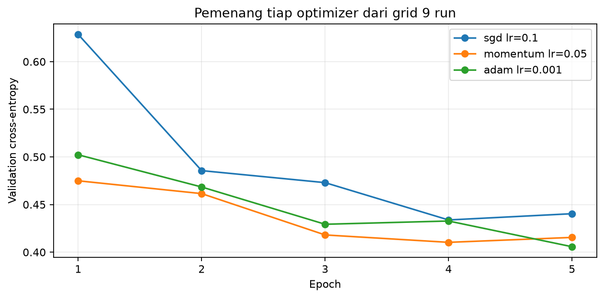

# Laporan Praktikum M03 - Optimizer dan Strategi Pelatihan

## Identitas Praktikan

| Komponen | Isian |
|---|---|
| Nama | Abdillah Fikri Alpome |
| NIM | 123450062 |
| Kelas | RC |
| Modul | M03 - Optimizer dan Strategi Pelatihan |
| Tanggal praktikum | 2026-10-27 |
| Seed/varian individual | 62 |
| Device | CPU, 2 thread |

## Ringkasan Singkat

Delapan belas run mencakup tiga baseline LR, sembilan grid optimizer, dan enam kondisi scheduler/batch. Model final batch_32 memiliki validation loss 0.396995, test loss 0.431508, dan test accuracy 0.8458; test dievaluasi satu kali setelah seluruh kandidat terkunci.

## 1. Tujuan dan Hipotesis

### 1.1 Tujuan

Memverifikasi implementasi sesuai protokol, membandingkan konfigurasi terkendali, dan membahas hasil berdasarkan angka eksperimen sendiri.

### 1.2 Hipotesis sebelum eksperimen

Adam diperkirakan cepat mencapai loss rendah; scheduler belum tentu membantu pada lima epoch. Batch 32 diperkirakan memberi loss lebih rendah melalui lebih banyak update, tetapi memerlukan lebih banyak waktu.

## 2. Data dan Protokol Eksperimen

### 2.1 Dataset dan split

Fashion-MNIST, subset train 12000/validation 3000 terstratifikasi seed 62 dari 60000 train resmi; test 10000 terpisah. Mean/std hanya dari subset train.

### 2.2 Konfigurasi yang dikendalikan

FNN 784-128-10, 101770 parameter, lima epoch. SGD/Momentum 0,9/Adam diuji pada LR masing-masing. Scheduler none/StepLR(step 2,gamma 0,5)/Cosine; batch 32/128/512 memakai optimizer/LR terbaik grid. Pemilihan dari 15 kandidat inti+tambahan, berdasarkan loss epoch terakhir.

### 2.3 Lingkungan eksekusi

Python 3.14.7; PyTorch 2.14.0+cpu; NumPy 2.5.3; CPU lokal DSWorkbench, kernel baru Run All. Versi dan jumlah thread tercetak di notebook.

## 3. Implementasi dan Pemeriksaan Kebenaran

Split terpisah, setiap kelas 1200 train dan 300 validation. Semua run memanggil fungsi sama, seed bobot/loader diulang. Seluruh 18 run dan 90 epoch tercatat; jumlah update batch 32=1875 dan 512=120; tepat satu test.

## 4. Hasil Eksperimen

### 4.1 Tabel hasil utama

| Run | Train CE | Val. CE | Val. acc | Detik/epoch |
|---|---|---|---|---|
| baseline_sgd_lr0.001 | 1.3368 | 1.3418 | 0.6553 | 0.292 |
| baseline_sgd_lr0.1 | 0.3848 | 0.4404 | 0.8390 | 0.292 |
| baseline_sgd_lr1 | 1.7547 | 1.7942 | 0.3257 | 0.279 |
| grid_sgd_lr0.01 | 0.5945 | 0.6026 | 0.7927 | 0.343 |
| grid_sgd_lr0.1 | 0.3848 | 0.4404 | 0.8390 | 0.299 |
| grid_sgd_lr0.5 | 0.4639 | 0.5407 | 0.7977 | 0.281 |
| grid_momentum_lr0.01 | 0.3757 | 0.4305 | 0.8457 | 0.295 |
| grid_momentum_lr0.05 | 0.3062 | 0.4155 | 0.8523 | 0.304 |
| grid_momentum_lr0.1 | 0.3359 | 0.4625 | 0.8423 | 0.292 |
| grid_adam_lr0.0001 | 0.5195 | 0.5352 | 0.8177 | 0.326 |
| grid_adam_lr0.001 | 0.3276 | 0.4057 | 0.8577 | 0.325 |
| grid_adam_lr0.01 | 0.3495 | 0.4563 | 0.8383 | 0.320 |
| scheduler_none | 0.3276 | 0.4057 | 0.8577 | 0.323 |
| scheduler_step | 0.3428 | 0.3996 | 0.8580 | 0.324 |
| scheduler_cosine | 0.3500 | 0.4034 | 0.8563 | 0.324 |
| batch_32 | 0.2846 | 0.3970 | 0.8570 | 0.565 |
| batch_128 | 0.3276 | 0.4057 | 0.8577 | 0.334 |
| batch_512 | 0.4064 | 0.4429 | 0.8480 | 0.268 |

### 4.2 Grafik atau visualisasi utama

**Gambar 1.** Cross-entropy validation sepanjang lima epoch untuk pemenang masing-masing optimizer; label mencantumkan LR. Kurva baseline dan scheduler/batch juga tersedia di notebook.

## 5. Analisis dan Pembahasan

Adam terbaik memakai LR 0.001, sedangkan SGD terbaik LR 0.1. Adam membagi momen pertama gradien dengan skala momen keduanya, sehingga nilai learning rate numerik yang sama tidak memberikan besar pembaruan yang sama seperti SGD. Tanpa scheduler diperoleh loss 0.405731; StepLR 0.399626; CosineAnnealingLR 0.403414, semuanya lima epoch. Scheduler tidak menjamin perbaikan: penurunan LR terlalu awal dapat membatasi langkah optimisasi ketika model belum cukup belajar. Batch 32 melakukan 1875 update, batch 512 hanya 120 pada lima epoch. Karena anggaran epoch tidak sama dengan anggaran waktu atau update, keuntungan satu batch perlu dibaca bersama runtime.

## 7. Kesimpulan dan Keterbatasan

### 7.1 Kesimpulan

Final batch_32 dipilih dari validation loss; test accuracy 0.8458. Pilihan efisiensi batch pada mesin ini adalah batch 512 menurut accuracy/runtime.

### 7.2 Keterbatasan

Satu seed, subset 12000 citra dan lima epoch tidak cukup untuk menyatakan optimizer terbaik pada semua dataset. Rasio accuracy/runtime hanyalah proxy karena waktu tiap run tidak dikunci sama.

### 7.3 Tindak lanjut

Ulangi eksperimen pada beberapa seed dan anggaran yang lebih panjang untuk menilai apakah pola tetap bertahan.

## Referensi

1. Materi dan starter resmi DSWorkbench Deep Learning versi 0.4.13.
2. Fabio Banyu Cyto. Implementasi praktikum Deep Learning, diadaptasi dengan izin. https://github.com/fabiobanyu/deep-learning-123450104
3. PyTorch Contributors. Dokumentasi PyTorch. https://docs.pytorch.org/docs/stable/
4. torchvision / scikit-learn untuk pemuatan dataset dan pembagian data sesuai modul.

## Pernyataan Orisinalitas

Implementasi mengadaptasi kode praktikum Fabio Banyu Cyto dengan izin serta starter DSWorkbench. Seluruh perhitungan dijalankan ulang menggunakan NIM individual. OpenAI Codex digunakan untuk membantu implementasi, pemeriksaan, dan penyusunan draf pembahasan. Hasil ini tidak diklaim sebagai kode yang seluruhnya ditulis tanpa bantuan. Praktikan meninjau dan memahami laporan sebelum pengumpulan.

**Nama:** Abdillah Fikri Alpome

**Tanggal:** 2026-10-27

## Checklist Sebelum Mengumpulkan

- [x] Identitas, seed, versi, device, dan sumber terisi.
- [x] Notebook selesai kernel baru Run All; angka laporan mengikuti hasil aktual.
- [x] Semua run tercatat dan grafik berlabel.
- [x] Pemilihan tidak menggunakan test; M02 tidak memakai split test.
- [ ] Praktikan meninjau laporan, mengisi formulir analisis, dan mengumpulkan tugas.
