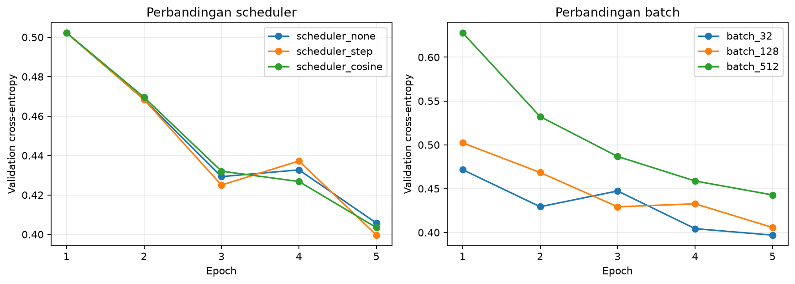

# Latihan Mandiri Modul 03

Abdillah Fikri Alpome | 123450062 | RC | 2026-10-27 | seed 62

## Prediksi sebelum menjalankan

Batch 32 diperkirakan melakukan lebih banyak update dan dapat menurunkan loss lebih jauh, tetapi runtime akan lebih lama dibanding batch 512. Karena anggaran sama-sama lima epoch, perbandingan belum adil bila tujuan sebenarnya adalah batas waktu yang sama. Prediksi tercatat sebelum training di hasil/prediksi-sebelum-run.json.

## Hitungan dan hasil aktual

ceil(12000/32)*5=1875 update; ceil(12000/512)*5=120 update. Rasio jumlah update adalah15,625 kali. Data, split, inisialisasi, optimizer, learning rate dan lima epoch sama; hanya batch berubah.

| Batch | Update | Val loss | Val accuracy | Runtime (s) |
|---|---|---|---|---|
| 32 | 1875 | 0.396995 | 0.8570 | 2.827 |
| 128 | 470 | 0.405731 | 0.8577 | 1.670 |
| 512 | 120 | 0.442860 | 0.8480 | 1.341 |

**Gambar 1.** Kiri membandingkan scheduler dan kanan batch size; sumbu horizontal epoch dan vertikal validation cross-entropy. Tiga kondisi batch memiliki jumlah update berbeda walaupun epoch sama.

## Perbandingan dengan prediksi

Batch 32 dikurangi batch 512 memberi selisih validation loss -0.045865, serta runtime +1.486 detik. Jumlah update yang lebih besar tidak boleh disamakan dengan optimizer yang secara intrinsik lebih baik. Jika efisiensi diukur sebagai validation accuracy dibagi runtime pada run lima epoch yang tersedia, batch 512 paling tinggi: accuracy 0.8480, waktu 1.34 detik, dan 120 update. Ini rekomendasi berdasarkan ukuran pendekatan efisiensi, bukan bukti pada eksperimen dengan batas waktu persis sama.

Implementasi mengadaptasi kode praktikum Fabio Banyu Cyto dengan izin serta starter DSWorkbench. Seluruh perhitungan dijalankan ulang menggunakan NIM individual. OpenAI Codex digunakan untuk membantu implementasi, pemeriksaan, dan penyusunan draf pembahasan.
