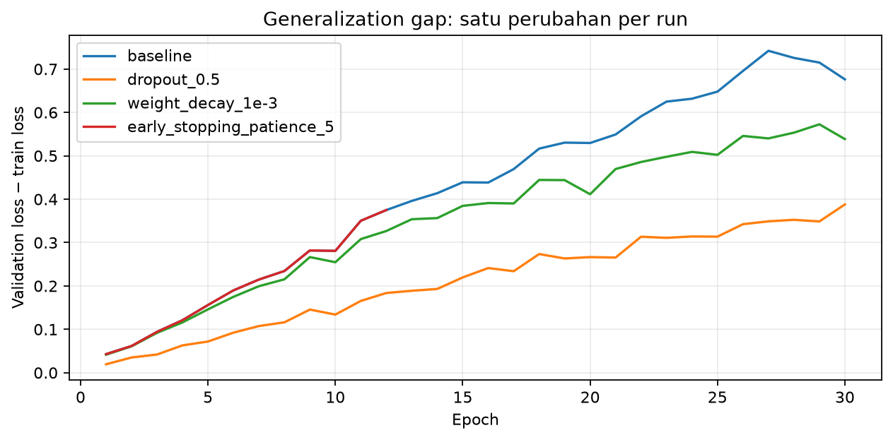

# Laporan Praktikum M04 - Regularisasi dan Hyperparameter Tuning

## Identitas Praktikan

| Komponen | Isian |
|---|---|
| Nama | Abdillah Fikri Alpome |
| NIM | 123450062 |
| Kelas | RC |
| Modul | M04 - Regularisasi dan Hyperparameter Tuning |
| Tanggal praktikum | 2026-10-27 |
| Seed/varian individual | 62 |
| Device | CPU, 2 thread |

## Ringkasan Singkat

Baseline dan tiga strategi regularisasi diuji terpisah, ditambah latihan dropout 0,2, dua belas random-search trial dan satu refit final. Trial random_11 menang dengan validation loss 0.430266. Refit menghasilkan loss validasi identik; test satu kali memberi loss 0.465573 dan accuracy 0.8349.

## 1. Tujuan dan Hipotesis

### 1.1 Tujuan

Memverifikasi implementasi sesuai protokol, membandingkan konfigurasi terkendali, dan membahas hasil berdasarkan angka eksperimen sendiri.

### 1.2 Hipotesis sebelum eksperimen

Baseline 512-512 pada 3000 train diperkirakan overfit; dropout 0,5 menekan gap tetapi lebih lambat. Dropout 0,2 diperkirakan menurunkan train loss lebih cepat daripada 0,5. Early stopping diperkirakan menghindari kenaikan loss validasi.

## 2. Data dan Protokol Eksperimen

### 2.1 Dataset dan split

Fashion-MNIST, train 3000/validation 3000 terstratifikasi seed 62; mean/std dihitung hanya pada train. Test 10000 baru dibuka setelah konfigurasi terkunci.

### 2.2 Konfigurasi yang dikendalikan

Baseline 784-512-512-10, Adam 0,001, batch 128, maksimal 30 epoch. Tiga strategi: dropout 0,5, WD 0,001, atau patience 5; setiap run hanya mengubah satu faktor. Search 81 kombinasi hidden 64/128/256, dropout 0/0,2/0,5, WD 0/1e-4/1e-3, LR 1e-4/3e-4/1e-3. Dua belas trial unik dipilih dengan seed 63 dan patience 5. Semua run memulihkan checkpoint loss validasi terbaik; hasil akhir epoch juga dicatat terpisah.

### 2.3 Lingkungan eksekusi

Python 3.14.7; PyTorch 2.14.0+cpu; NumPy 2.5.3; CPU lokal DSWorkbench, kernel baru Run All. Versi dan jumlah thread tercetak di notebook.

## 3. Implementasi dan Pemeriksaan Kebenaran

Baseline 669706 parameter; split tanpa overlap, masing-masing 300 train dan 300 validation per kelas. Dua belas kombinasi search unik; refit mengulang loss validasi pemenang tepat dalam toleransi 1e-10. Metrics mencatat 18 run termasuk latihan dan refit; test satu lintasan.

## 4. Hasil Eksperimen

### 4.1 Tabel hasil utama

| Run | Hidden | Dropout | WD | LR | Epoch best/stop | Val loss | Gap | Val acc |
|---|---|---|---|---|---|---|---|---|
| baseline | 512 | 0.0 | 0 | 0.001 | 7/30 | 0.45577 | 0.21475 | 0.8357 |
| dropout_0.5 | 512 | 0.5 | 0 | 0.001 | 21/30 | 0.44232 | 0.26544 | 0.8533 |
| weight_decay_1e-3 | 512 | 0.0 | 0.001 | 0.001 | 7/30 | 0.45202 | 0.19944 | 0.8393 |
| early_stopping_patience_5 | 512 | 0.0 | 0 | 0.001 | 7/12 | 0.45577 | 0.21475 | 0.8357 |
| dropout_0.2 | 512 | 0.2 | 0 | 0.001 | 7/30 | 0.44936 | 0.18491 | 0.8400 |
| random_01 | 64 | 0.2 | 0.0001 | 0.0003 | 30/30 | 0.45974 | 0.10983 | 0.8333 |
| random_02 | 64 | 0.2 | 0.0001 | 0.001 | 19/24 | 0.44309 | 0.17182 | 0.8423 |
| random_03 | 64 | 0.2 | 0.001 | 0.0001 | 30/30 | 0.57403 | 0.03064 | 0.7953 |
| random_04 | 128 | 0.2 | 0.001 | 0.0003 | 27/30 | 0.43280 | 0.15935 | 0.8467 |
| random_05 | 128 | 0.5 | 0.001 | 0.0003 | 30/30 | 0.46398 | 0.10768 | 0.8310 |
| random_06 | 128 | 0.0 | 0.0001 | 0.0003 | 21/26 | 0.45092 | 0.16270 | 0.8403 |
| random_07 | 128 | 0.2 | 0 | 0.001 | 12/17 | 0.44432 | 0.15945 | 0.8423 |
| random_08 | 64 | 0.5 | 0 | 0.0001 | 30/30 | 0.69553 | 0.01873 | 0.7627 |
| random_09 | 256 | 0.2 | 0.0001 | 0.0001 | 30/30 | 0.45773 | 0.09862 | 0.8370 |
| random_10 | 128 | 0.2 | 0.0001 | 0.0001 | 30/30 | 0.50045 | 0.05963 | 0.8227 |
| random_11 | 256 | 0.2 | 0.0001 | 0.001 | 10/15 | 0.43027 | 0.17539 | 0.8480 |
| random_12 | 256 | 0.5 | 0 | 0.0001 | 30/30 | 0.49013 | 0.05228 | 0.8273 |
| final_retrain | 256 | 0.2 | 0.0001 | 0.001 | 10/15 | 0.43027 | 0.17539 | 0.8480 |

### 4.2 Grafik atau visualisasi utama

**Gambar 1.** Gap=validation loss-train loss, keduanya dihitung dalam eval mode. Garis dibedakan berdasarkan strategi dan berakhir pada epoch berhenti masing-masing. Nilai pada tabel berasal dari checkpoint validasi terbaik, bukan selalu epoch terakhir.

## 5. Analisis dan Pembahasan

Baseline menunjukkan validation loss minimum 0.455766 pada epoch 7, lalu lebih tinggi sesudahnya, misalnya epoch 8. Pada epoch terakhir loss validasi 0.698454 dan gap 0.676323; ketidakseimbangan train-validation ini menjadi bukti overfitting. Di antara baseline dan tiga strategi terpisah, gap checkpoint terkecil dimiliki weight_decay_1e-3 sebesar 0.199436, sedangkan validation loss terendah dimiliki dropout_0.5 sebesar 0.442318. Gap kecil saja dapat muncul karena underfitting; karena itu tetap perlu melihat kedua loss. Secara deskriptif, learning_rate memiliki rentang rerata validation loss antarkelompok terbesar: nilai 0.0001 memberi rerata 0.543574, sedangkan 0.001 memberi 0.439228. Namun hanya 12 dari 81 kombinasi diuji dan jumlah anggota tiap kelompok tidak seimbang; faktor lain ikut berubah, sehingga ini bukan bukti pengaruh kausal tunggal.

## 7. Kesimpulan dan Keterbatasan

### 7.1 Kesimpulan

Konfigurasi final random_11 memiliki test accuracy 0.8349. Model final memiliki validation loss 0.430266 dan test loss 0.465573, sehingga test minus validation adalah +0.035307. Ini menggambarkan perbedaan hasil pada dua split untuk model terpilih, bukan alasan menyesuaikan hyperparameter setelah melihat test; hanya satu lintasan test dilakukan.

### 7.2 Keterbatasan

Subset 3000 citra, satu seed dan hanya 12 dari 81 kombinasi membatasi kesimpulan. Perbandingan checkpoint terbaik dan epoch terakhir harus dibedakan; search tidak membuktikan pengaruh kausal satu hyperparameter.

### 7.3 Tindak lanjut

Ulangi eksperimen pada beberapa seed dan anggaran yang lebih panjang untuk menilai apakah pola tetap bertahan.

## Referensi

1. Materi dan starter resmi DSWorkbench Deep Learning versi 0.4.13.
2. Fabio Banyu Cyto. Implementasi praktikum Deep Learning, diadaptasi dengan izin. https://github.com/fabiobanyu/deep-learning-123450104
3. PyTorch Contributors. Dokumentasi PyTorch. https://docs.pytorch.org/docs/stable/
4. torchvision / scikit-learn untuk pemuatan dataset dan pembagian data sesuai modul.

## Pernyataan Orisinalitas

Implementasi mengadaptasi kode praktikum Fabio Banyu Cyto dengan izin serta starter DSWorkbench. Seluruh perhitungan dijalankan ulang menggunakan NIM individual. OpenAI Codex digunakan untuk membantu implementasi, pemeriksaan, dan penyusunan draf pembahasan. Hasil ini tidak diklaim sebagai kode yang seluruhnya ditulis tanpa bantuan. Praktikan meninjau dan memahami laporan sebelum pengumpulan.

**Nama:** Abdillah Fikri Alpome

**Tanggal:** 2026-10-27

## Checklist Sebelum Mengumpulkan

- [x] Identitas, seed, versi, device, dan sumber terisi.
- [x] Notebook selesai kernel baru Run All; angka laporan mengikuti hasil aktual.
- [x] Semua run tercatat dan grafik berlabel.
- [x] Pemilihan tidak menggunakan test; M02 tidak memakai split test.
- [ ] Praktikan meninjau laporan, mengisi formulir analisis, dan mengumpulkan tugas.
