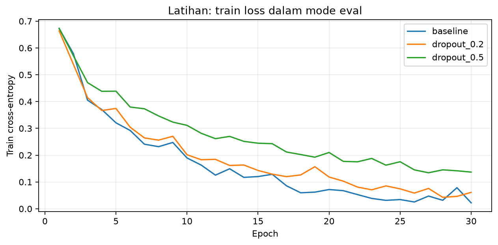

# Latihan Mandiri Modul 04

Abdillah Fikri Alpome | 123450062 | RC | 2026-10-27 | seed 62

## Prediksi sebelum menjalankan

Dropout 0,2 diperkirakan menurunkan train loss lebih cepat daripada 0,5 karena lebih banyak unit aktif. Dropout 0,5 diperkirakan mengurangi gap lebih kuat, tetapi dapat memperlambat pelatihan. Prediksi disimpan sebelum run pertama di hasil/prediksi-sebelum-run.json.

## Protokol dan hasil aktual

Semua kondisi memakai baseline784-512-512-10, Adam 0,001, batch 128,30 epoch; hanya probabilitas dropout berubah. Loss train/validation dihitung dalam eval mode sehingga mask dropout tidak mengacaukan pengukuran gap. Tabel menunjukkan checkpoint terbaik berdasarkan aturan pemilihan yang sama pada kedua run; kurva menampilkan seluruh epoch.

| Kondisi | Train loss | Val loss | Gap | Epoch terbaik |
|---|---|---|---|---|
| baseline | 0.241019 | 0.455766 | 0.214747 | 7 |
| dropout_0.2 | 0.264448 | 0.449358 | 0.184910 | 7 |
| dropout_0.5 | 0.176878 | 0.442318 | 0.265440 | 21 |

**Gambar 1.** Train cross-entropy tanpa mask dropout pada setiap epoch; legenda membedakan baseline, dropout 0,2 dan 0,5. Interpretasi kecepatan menggunakan kurva dan histori, bukan membandingkan checkpoint pada epoch berbeda tanpa catatan.

## Perbandingan prediksi dan hasil

Pada epoch 5 yang sama, train loss dropout 0,2 sebesar 0.374257, dibanding 0.438686 pada dropout 0,5; hasil ini mendukung prediksi penurunan lebih cepat. Train loss pada checkpoint 0,2 dikurangi 0,5 adalah +0.087570; gap berubah dari 0.265440 pada 0,5 menjadi 0.184910 pada 0,2. Epoch terbaik masing-masing 7 dan 21. Regularisasi yang lebih kuat belum tentu memberi validation loss terbaik; besarnya gap perlu dibaca bersama kedua loss. Satu seed tidak cukup untuk menggeneralisasi tingkat dropout optimal. Pada checkpoint terbaik, validation loss dropout 0,2 adalah 0.449358, sedangkan dropout 0,5 adalah 0.442318; prediksi bahwa dropout 0,5 memperkecil gap tidak didukung oleh hasil ini. Dropout yang terlalu besar menghilangkan banyak unit saat training sehingga kapasitas efektif berkurang dan optimisasi melambat; jika terjadi underfitting, train loss dan validation loss dapat sama-sama memburuk. Percobaan ini tidak menunjukkan kedua loss memburuk secara bersamaan pada checkpoint terbaik. Catatan prediksi awal menekankan train loss dan gap; arah validation loss belum dicatat secara eksplisit sebelum run.

Implementasi mengadaptasi kode praktikum Fabio Banyu Cyto dengan izin serta starter DSWorkbench. Seluruh perhitungan dijalankan ulang menggunakan NIM individual. OpenAI Codex digunakan untuk membantu implementasi, pemeriksaan, dan penyusunan draf pembahasan.
